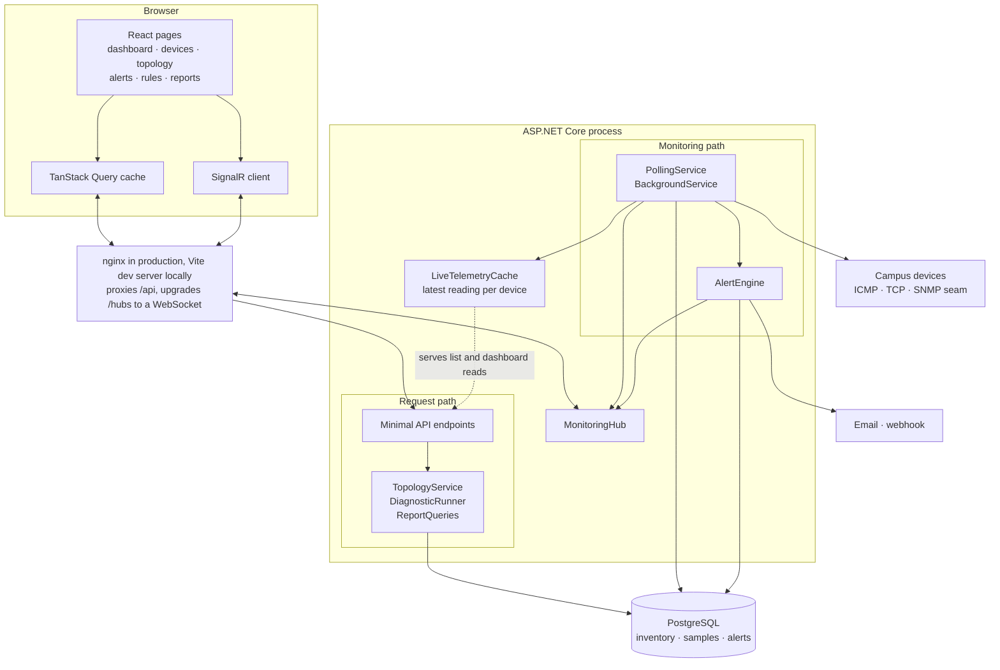
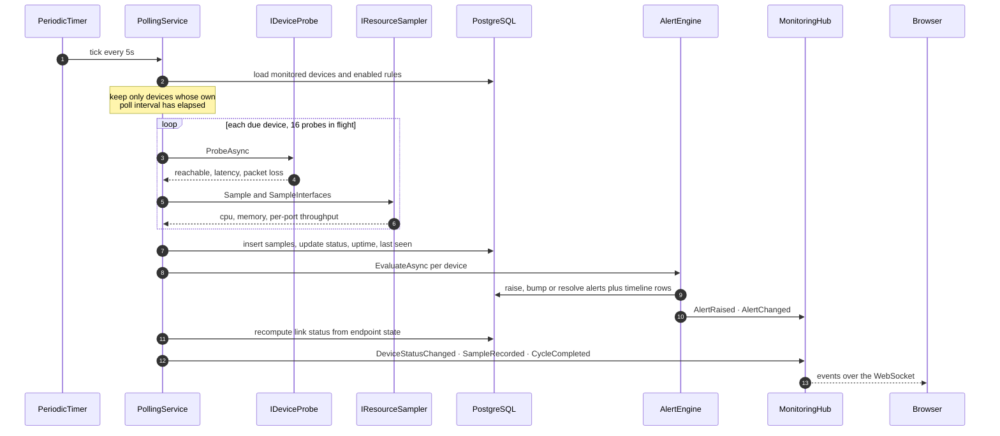
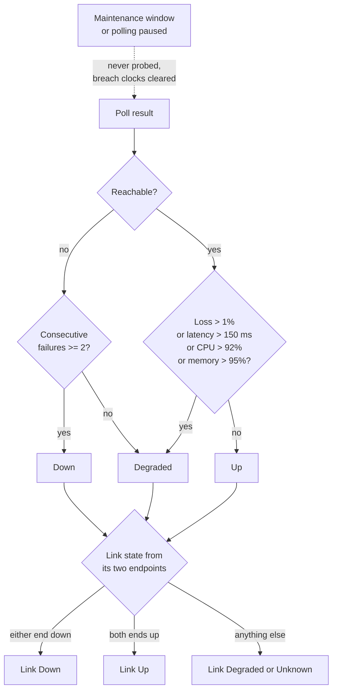
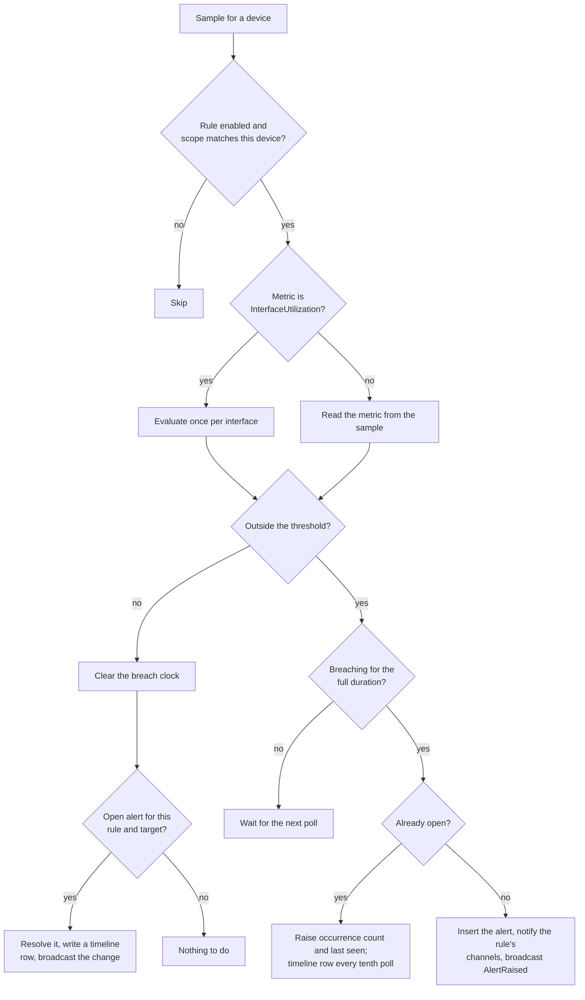
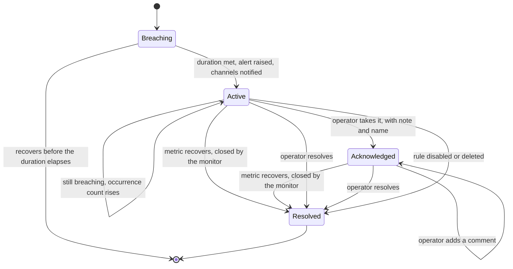
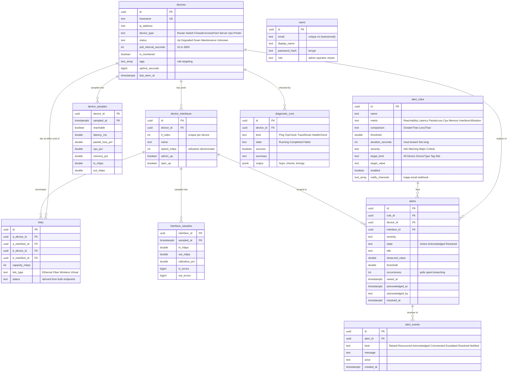
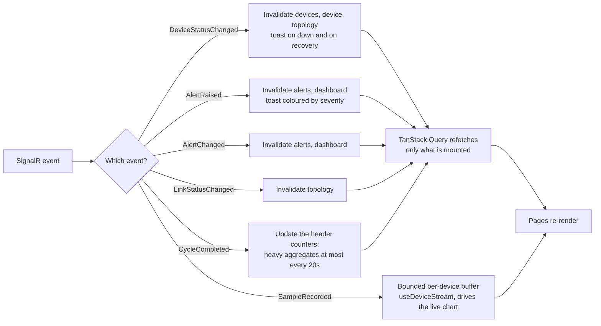
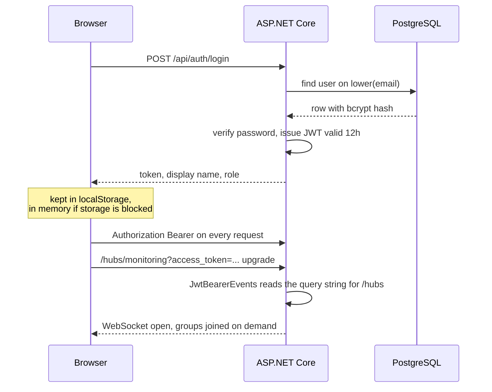
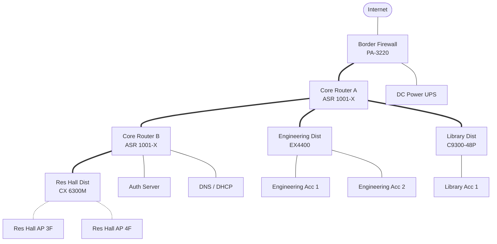

# Network Management System

Monitoring and management for a university campus network: device inventory,
live availability and utilization, topology, alerting with an acknowledgment
workflow, on-demand diagnostics, and reporting.

React + TypeScript on the front, ASP.NET Core on the back, PostgreSQL for
inventory and time-series samples, SignalR for live updates.


## What it does

**Live monitoring.** A background poller probes every device on its own
interval, stores a sample, re-derives device and link state, and pushes the
result to connected browsers over a WebSocket. Nothing in the UI polls for a
page refresh: status changes, new alerts and cycle summaries arrive as events.

**Topology.** Links between devices and interfaces are first-class records.
The graph is laid out in tiers by hop distance from the core, so the picture
matches how the network is actually built, and a path finder answers "how do we
get from here to there, and what is in the way".

**Alerting.** Rules compare a metric (reachability, latency, loss, CPU, memory,
interface utilization) against a threshold for a duration, scoped to all
devices, a type, a tag, a site or one device. A breach opens exactly one alert
per target, raises its occurrence count while it persists, notifies the chosen
channels, and auto-resolves when the metric comes back. Operators acknowledge,
comment and resolve; every transition lands on the alert timeline.

**Diagnostics.** Ping, TCP port check, traceroute and a composite health check
that scores reachability, latency, loss, CPU, memory, interface state, uplink
headroom, 24-hour availability and open alerts in one pass.

**Reporting.** Interface utilization with peaks and errors, device uptime with
outage counts and downtime, alert trends by severity with mean time to
acknowledge and resolve, plus CSV export.

## Running it

```bash
docker compose up --build
```

- UI: http://localhost:5173
- API + Swagger: http://localhost:5080/swagger
- Sign in with `admin@campus.edu` / `ChangeMe123!`

The API applies `db/schema.sql` on startup, seeds a sample campus from
`db/seed.sql`, and creates the admin account from the `Admin:*` settings. It
starts in **synthetic** monitoring mode, which generates deterministic
telemetry so the whole stack is usable without a lab full of switches.

### Running the pieces directly

```bash
# Postgres
docker compose up -d db

# API (http://localhost:5080)
cd server && dotnet run --project src/Nms.Api

# Web (http://localhost:5173, proxies /api and /hubs to the API)
cd web && npm install && npm run dev
```

### Tests

```bash
cd server && dotnet test
```

They cover the parts worth pinning down without a database: rule targeting and
threshold edges, poll scheduling, breach timing, and the bounds the synthetic
telemetry has to respect.

# Design

## How the pieces fit

One ASP.NET Core process serves the API, hosts the SignalR hub and runs the
poller, so a sample can go from probe to browser without a queue or a second
service in between. Everything durable lives in Postgres; the only in-memory
state is the latest reading per device and the breach clocks, both of which are
cheap to lose on restart.



## What one poll cycle does

This loop is the system. Probes run in parallel because they are network-bound;
database writes are sequential because they share one `DbContext`. A cycle for
the seeded campus — 14 devices, 18 interfaces — completes in roughly 150 ms.



## How state is derived

Device state is a function of the sample, not something an operator sets. Link
state falls out of the two devices it joins, which is why a single switch going
down greys out everything behind it on the topology without any extra
bookkeeping.



## How a rule becomes an alert

Every enabled rule whose scope matches the device is evaluated on every poll.
The duration test is what keeps a single slow ping from paging anyone, and the
"already open" test is what keeps a persistent problem to one row instead of
one row per poll.



## The life of an alert

A partial unique index on `alerts` keeps one open row per device, rule and
interface, so two overlapping cycles cannot double-raise. Resolution has three
sources: the metric recovering, an operator, or the rule itself going away —
that last one matters because an alert from a deleted rule would otherwise
never clear.



## The data model

Inventory is small and relational; samples are append-only and large, so they
get composite primary keys and BRIN indexes on time rather than the usual
b-tree on a surrogate id. `alert_events` is the audit trail behind the
acknowledgment workflow — every raise, notification, comment and resolution.



## How the browser stays current

Query results are the source of truth for anything a page renders; hub events
only say what went stale. The one exception is the per-device sample stream,
which feeds a bounded in-memory buffer so the live chart can draw a point every
poll without touching the cache or the network.



Only the device page subscribes to a sample stream, and it subscribes to one
device: the hub sends `SampleRecorded` to a per-device group, so a browser on
the alert queue never receives telemetry it would throw away.

## Authentication

A JWT carries the user id, name and role. The hub cannot use the same header a
fetch would, because browsers do not let you set headers on a WebSocket
handshake — so the token rides in the query string and `JwtBearerEvents` lifts
it back out for paths under `/hubs`.



Any signed-in user can view, run diagnostics and work the alert queue.
Inventory changes — devices, interfaces, links and rules — require the `admin`
role through the `ManageInventory` policy.

## The campus the seed data models

`db/seed.sql` builds a small but realistic campus so every feature has
something to show on first boot. Thick lines are 10G fiber, thin lines 1G
copper, dashed lines wireless. Tier is not stored: the API computes it as hop
distance from the routers and firewalls, and the UI lays the graph out in those
bands.



Seven alert rules ship with it: unreachable devices, a latency spike rule
scoped to the `critical` tag, fleet-wide latency and packet loss, switch CPU,
memory pressure, and uplink congestion on any interface.

## Decisions worth knowing

**SQL-first schema.** Tables, constraints and the rollup view live in
`db/schema.sql` rather than in generated migrations. The interesting parts of
this schema are a partial unique index that keeps one alert open per target,
BRIN indexes on the sample tables, and filtered aggregates in the view — all
clearer as SQL than as C#. EF Core maps onto it for inventory and CRUD;
analytics are hand-written queries where bucketing and window functions do the
work.

**Breach timing is in memory.** "Above 85% for five minutes" needs to know when
the breach started. That lives in a `BreachTracker` rather than the database,
so a restart starts the clock over instead of resurrecting a stale breach.

**One probe interface, two implementations.** `IDeviceProbe` is either real
ICMP with a TCP fallback or a deterministic generator, chosen by config.
`IResourceSampler` is the same idea for counters and the seam where SNMP or
gNMI belongs; nothing above it changes when that arrives.

**One axis per chart.** Charts are hand-rolled SVG rather than a chart library:
it keeps every series on a single scale, the categorical order
colourblind-safe, and the hover layer consistent across the app.

## Monitoring real devices

Set `Monitoring__Mode=live` and the poller sends real ICMP echo requests,
falling back to a TCP connect on 443/22/80/161 when ICMP is unavailable.
Interface and resource counters still come from the synthetic sampler:
`IResourceSampler` is the seam where an SNMP or gNMI collector plugs in, and
nothing above it changes when it does.

Useful settings (`server/src/Nms.Api/appsettings.json`, or `__`-separated
environment variables):

| Setting | Default | What it does |
| --- | --- | --- |
| `Monitoring:Mode` | `synthetic` | `live` sends real probes |
| `Monitoring:TickSeconds` | `5` | How often the poller looks for due devices |
| `Monitoring:FailuresBeforeDown` | `2` | Missed polls before a device is marked down |
| `Monitoring:DegradedLatencyMs` | `150` | Latency that counts as degraded |
| `Monitoring:RetentionDays` | `30` | Sample retention; older rows are pruned hourly |
| `Notifications:WebhookUrl` | — | Alerts POST here when a rule asks for `webhook` |
| `Auth:SigningKey` | dev value | **Replace this.** JWT signing key |

## Project layout

```
db/            schema.sql and seed.sql (SQL-first; applied at startup)
server/        ASP.NET Core API (src/Nms.Api, tests/Nms.Api.Tests)
  Domain/      entities and the rules that belong to them
  Data/        EF Core mapping and the startup bootstrapper
  Monitoring/  probes, telemetry, the poll loop, topology, diagnostics
  Alerting/    rule evaluation, breach timing, notifications
  Reporting/   analytics SQL
  Endpoints/   minimal API surface
  Hubs/        SignalR hub and broadcaster
web/           React + TypeScript UI
  charts/      SVG chart primitives
  features/    dashboard, devices, topology, alerts, reports
  realtime/    hub client and live cache patching
```
